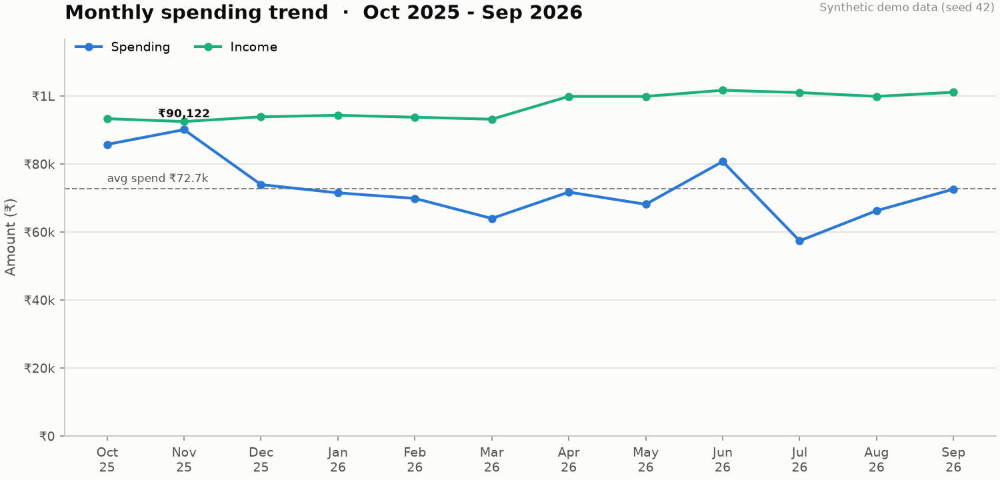
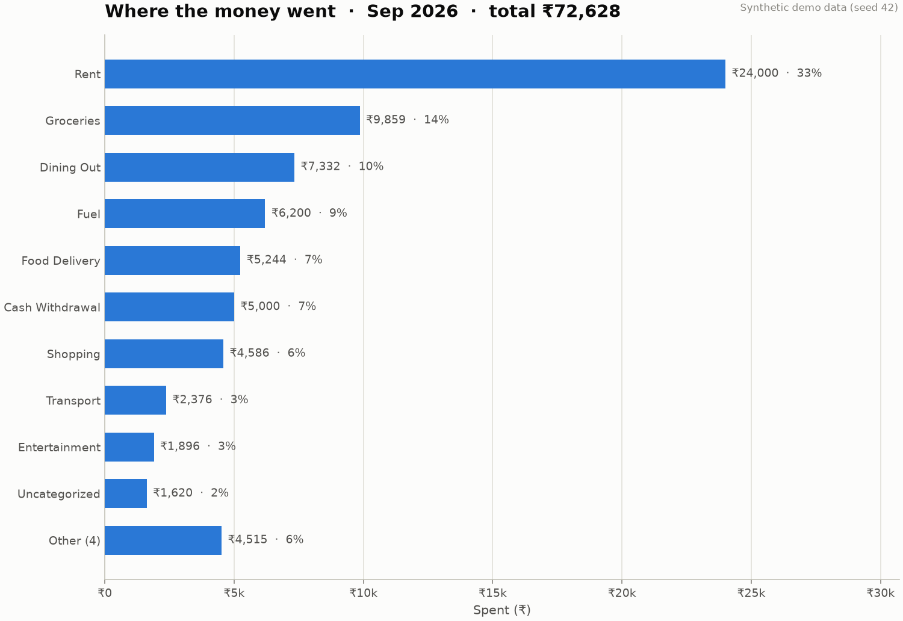
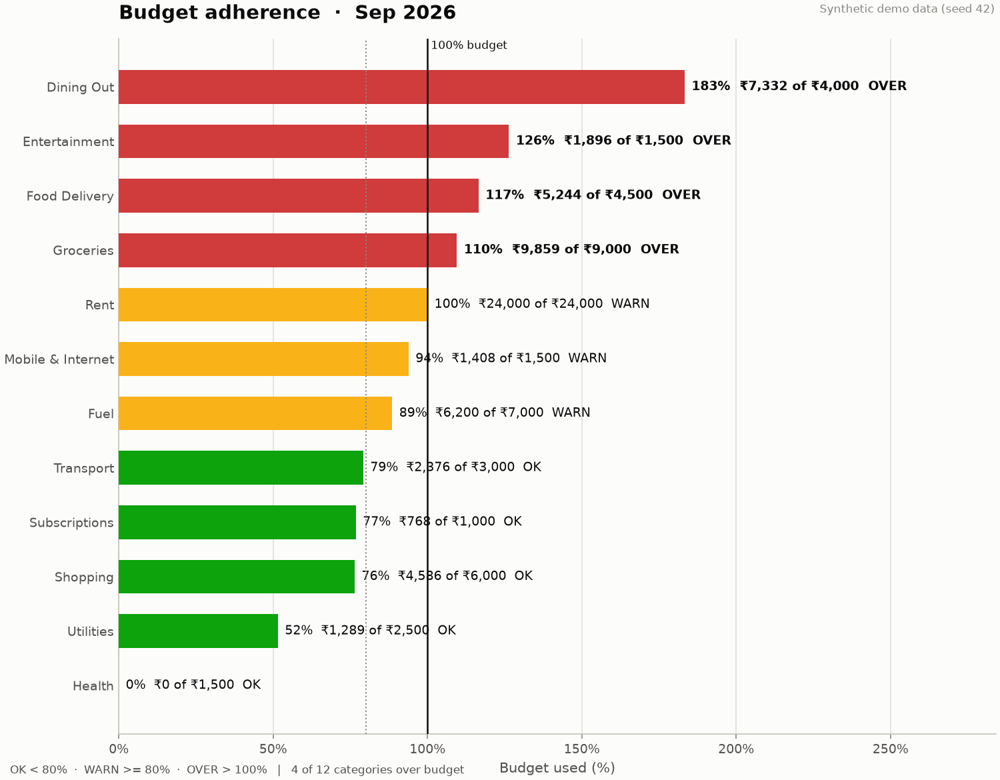
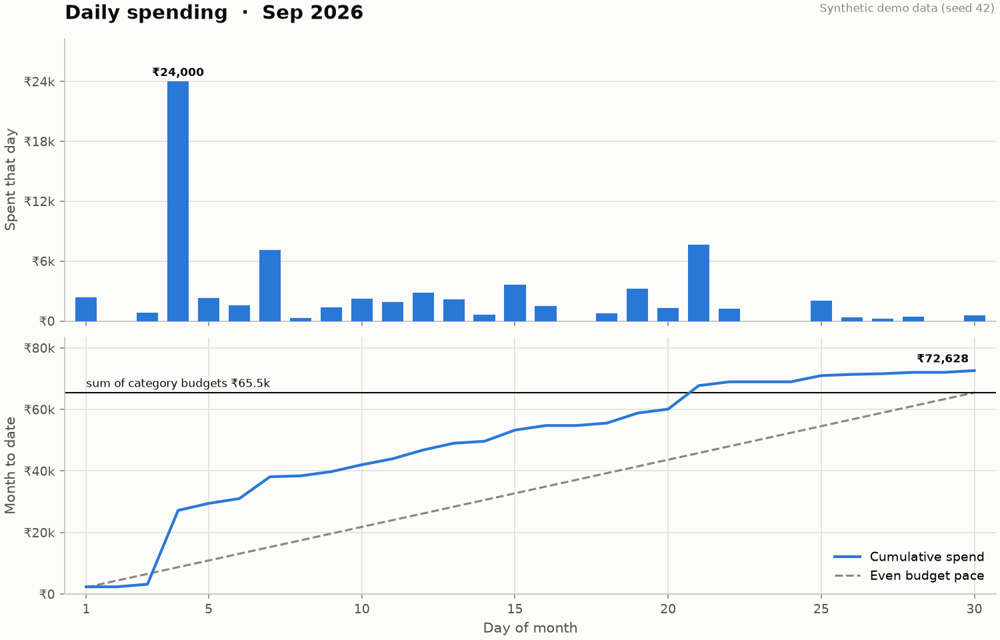
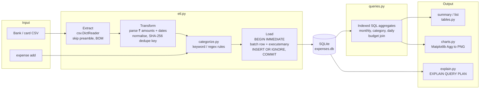
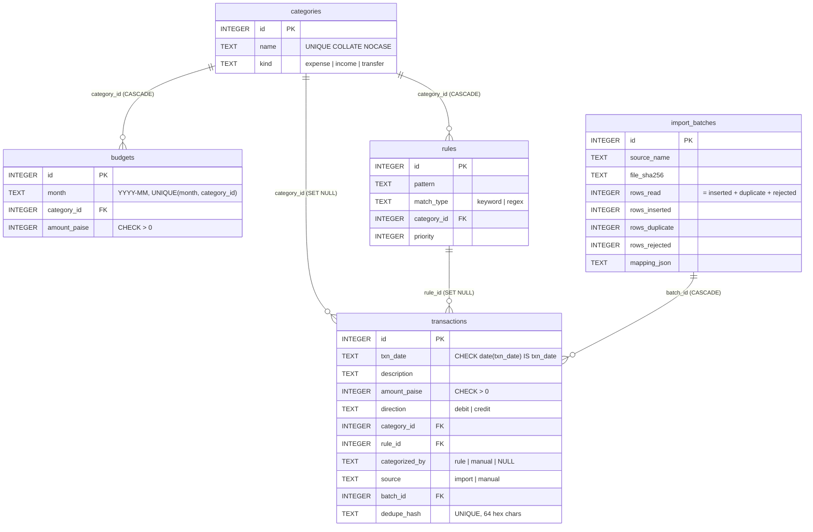

# Personal Expense Dashboard

[](https://github.com/Worldisbinary/expense-dashboard/actions/workflows/ci.yml)


A command-line finance dashboard for daily expense tracking and budgeting, built on
**Python, SQLite, SQL and Matplotlib**. It imports bank and credit-card statement CSVs
through an idempotent ETL pipeline, categorises transactions with user-editable rules,
tracks monthly budgets per category, and renders time-series and category reports as PNG
charts, so you never have to maintain a spreadsheet.

Runtime dependencies: the standard library (`sqlite3`, `argparse`, `csv`, `decimal`) and
`matplotlib`. That's all.

```text
$ expense summary --month 2026-09
Summary for Sep 2026
  Spent         ₹72,628.00  (+9.6% vs Aug 2026)
  Income        ₹1,01,124.00
  Net           ₹28,496.00
  Transactions  70
  Budgets       ₹64,958.00 of ₹65,500.00 used (99%)

Category                Spent      Budget  Used   Remaining  Status
-----------------  ----------  ----------  ----  ----------  ------
Dining Out          ₹7,332.00   ₹4,000.00  183%  -₹3,332.00  OVER
Entertainment       ₹1,896.00   ₹1,500.00  126%    -₹396.00  OVER
Food Delivery       ₹5,244.00   ₹4,500.00  117%    -₹744.00  OVER
Groceries           ₹9,859.00   ₹9,000.00  110%    -₹859.00  OVER
Rent               ₹24,000.00  ₹24,000.00  100%       ₹0.00  WARN
Mobile & Internet   ₹1,408.00   ₹1,500.00   94%      ₹92.00  WARN
Fuel                ₹6,200.00   ₹7,000.00   89%     ₹800.00  WARN
Transport           ₹2,376.00   ₹3,000.00   79%     ₹624.00  OK
Subscriptions         ₹768.00   ₹1,000.00   77%     ₹232.00  OK
Shopping            ₹4,586.00   ₹6,000.00   76%   ₹1,414.00  OK
Utilities           ₹1,289.00   ₹2,500.00   52%   ₹1,211.00  OK
Health                  ₹0.00   ₹1,500.00    0%   ₹1,500.00  OK
Cash Withdrawal     ₹5,000.00                                -
Uncategorized       ₹1,620.00                                -
Personal Care       ₹1,050.00                                -
-----------------  ----------  ----------  ----  ----------  ------
Total              ₹72,628.00  ₹65,500.00

OVER BUDGET in 4 categories: Dining Out (+₹3,332.00), Entertainment (+₹396.00), Food Delivery (+₹744.00), Groceries (+₹859.00)
```

> All data in this README is **synthetic**, produced by `expense demo` (seed 42). No real
> financial data is included in this repository.

## Features

- **SQLite schema in a versioned `.sql` migration**: categories, transactions, monthly
  budgets, categorisation rules and import batches, with foreign keys enforced,
  `CHECK` constraints on every column that can be wrong, and indexes chosen for the real
  queries (proved with `EXPLAIN QUERY PLAN`, see `expense explain`).
- **ETL for bank-statement CSVs**:
  - auto-detected or configurable column mapping (CLI flags or a JSON file)
  - split *Withdrawal/Deposit* columns, signed *Amount* columns, or *Amount + Dr/Cr*
  - Indian ₹ amounts (`₹1,23,456.78`, `Rs. 450`, `INR`, `(500.00)`, `1,200 Dr`)
  - `DD/MM/YYYY`, `DD-Mon-YYYY` and ISO dates
  - bank preamble lines, BOMs and other encodings
  - bad rows reported with their line numbers instead of crashing the import
- **Idempotent imports**: each row gets a SHA-256 identity from (date, signed amount,
  normalised description, occurrence). The unique index plus `INSERT OR IGNORE` makes
  re-importing a file, or an overlapping statement, a no-op for rows already stored.
- **Atomic loads**: one explicit transaction per file: audit row in `import_batches`, a
  single `executemany` bulk insert, and the batch counters. Any failure rolls back
  everything. `expense batches undo N` removes an import via `ON DELETE CASCADE`.
- **Rule-based auto-categorisation**: keyword rules (whole-token matching, so `ola` does
  not match `GRANOLA`) and regex rules with priorities, stored in the database and
  editable from the CLI. Manual categorisations are never overwritten by rules.
- **Budgets**: per category per month, with % used, remaining, and `OK` / `WARN` (≥80%) /
  `OVER` (>100%) flags.
- **Real-time aggregation**: monthly, per-category and daily totals are computed by SQL
  on demand from the transactions table. There are no summary tables to go stale.
- **Matplotlib reports** (Agg backend, headless): monthly spending trend, category
  breakdown, budget adherence, and daily spending with month-to-date burn against
  budget pace.
- **Synthetic data generator**: 12 months of realistic Indian personal finance (salary,
  rent, UPI, Swiggy/Zomato, groceries, fuel, subscriptions, card bills) for demos.
- **Tests**: 256 pytest tests, 99% line+branch coverage (see [Testing](#testing)).

## Quickstart

```bash
git clone https://github.com/Worldisbinary/expense-dashboard.git
cd expense-dashboard
python -m venv .venv
source .venv/bin/activate          # Windows: .venv\Scripts\activate
pip install -e ".[dev]"

# Option A: explore with synthetic data
expense --db demo.db demo --end-month 2026-09 --report reports
expense --db demo.db summary
expense --db demo.db explain

# Option B: your own data
expense init                                   # creates ./expenses.db with starter rules
expense import examples/sample_statement.csv   # columns auto-detected
expense add 249 "Lunch at Truffles" --date 2026-10-15
expense budget set Groceries 9000 --month 2026-10 --through 2027-03
expense summary
expense report --out reports
```

The database location defaults to `./expenses.db`; override it with `--db PATH` or the
`EXPENSE_DB` environment variable.

## Commands

| Command | What it does |
|---|---|
| `init` | Create or migrate the database; seed starter categories and rules. |
| `add AMOUNT DESC [--date --category --income --note]` | Record a transaction by hand (rules apply if no category). |
| `import FILE... [--mapping m.json] [--date-col ...] [--dry-run] [--strict]` | Run the ETL pipeline on CSV statements. |
| `batches list` / `batches undo ID` | Audit trail of imports; roll one back. |
| `list [--month --from --to --category --uncategorized --search --min --max --debits/--credits]` | Filtered transaction listing with net total. |
| `categories list/add/delete` | Manage categories (`expense`, `income`, `transfer` kinds). |
| `rules list/add/delete/test` | Manage categorisation rules; `test` shows which rule a description hits. |
| `categorize [--all] [--dry-run]` / `categorize --txn ID --category NAME` | Re-apply rules or override one row. |
| `budget set CAT AMOUNT [--month --through]` / `budget list` / `budget delete` | Monthly budgets (upsert). |
| `summary [--month]` | Month totals, change vs previous month, per-category spend vs budget. |
| `report [--month --months 12 --out DIR]` | Write the four PNG charts. |
| `explain [--query NAME] [--benchmark]` | `EXPLAIN QUERY PLAN` for every main query; exits 1 if an expected index is unused. |
| `demo [--seed --end-month --months --report DIR]` | Build a database from synthetic statements via the real import path. |

### Importing other layouts

Column names are auto-detected from common aliases (`Date`/`Txn Date`/`Value Date`,
`Narration`/`Description`/`Particulars`/`Remarks`, `Withdrawal Amt.`/`Debit`,
`Deposit Amt.`/`Credit`, `Amount`, `Dr/Cr`). Anything else can be mapped explicitly:

```bash
# credit-card export: ISO dates, purchases are positive numbers
expense import card.csv --debit-positive

# statement with 2 preamble lines before the header
expense import statement.csv --skip-rows 2

# fully custom layout (see examples/custom_mapping.json)
expense import examples/custom_export.csv --mapping examples/custom_mapping.json
```

```json
{
  "date": "Posted",
  "description": "Payee",
  "amount": "Spent",
  "amount_sign": "debit_positive",
  "date_format": "%m/%d/%Y",
  "delimiter": "|"
}
```

Re-importing is safe:

```text
$ expense import demo_data/savings_account.csv --skip-rows 2
savings_account.csv: read 689, inserted 0, skipped 689 duplicate(s), rejected 0 (batch #3)
```

## Screenshots

Generated from synthetic data with `python scripts/build_readme_images.py`.

**Monthly spending trend**: spending vs income over 12 months, average spend marked.



**Category breakdown**: where the money went in one month; small categories fold into
*Other*.



**Budget adherence**: % of each budget used, coloured *and* labelled by status.



**Daily spending**: spend per day, and month-to-date spend against an even budget pace.



## Architecture



| Module | Responsibility |
|---|---|
| `db.py` | Connections (`foreign_keys=ON`), explicit `transaction()` context manager, migrations tracked in `PRAGMA user_version`. |
| `migrations/0001_initial.sql` | The schema, constraints and indexes, with the reasoning in comments. |
| `money.py` | `Decimal`-based ₹ parsing to integer paise; Indian digit grouping (`1,23,456.78`). |
| `etl.py` | Column mapping, date parsing, transform, dedupe hashing, atomic load, undo. |
| `categorize.py` | Rule compilation, matching, bulk re-categorisation. |
| `queries.py` | Filtered retrieval, aggregates, budget maths, manual inserts. |
| `charts.py` | The four report charts. |
| `explain.py` | Query-plan inspection and indexed vs `NOT INDEXED` benchmarks. |
| `demo.py` | Seeded synthetic statement generator. |
| `cli.py` / `tables.py` | argparse front end and dependency-free table rendering. |

## Schema



**Indexes**, each tied to a query that `expense explain` checks:

| Index | Serves |
|---|---|
| `ux_transactions_dedupe_hash (dedupe_hash)` UNIQUE | `INSERT OR IGNORE` dedupe, dry-run probes |
| `idx_transactions_date (txn_date, direction, category_id, amount_paise)` | monthly trend, category totals, daily totals: range seek on `txn_date`, *covering* |
| `idx_transactions_category_date (category_id, txn_date, direction, amount_paise)` | budget-adherence join and `list --category --month`: equality + range seek |
| `sqlite_autoindex_budgets_1 (month, category_id)` from the `UNIQUE` | budget lookup `WHERE month = ?` and the upsert conflict target |
| `idx_transactions_batch (batch_id)`, `idx_rules_category (category_id)` | foreign-key child lookups on cascade deletes |

```text
$ expense explain --query budget_adherence
== budget_adherence: budgets joined to that month's spending in each budgeted category
|-- SEARCH b USING INDEX sqlite_autoindex_budgets_1 (month=?)
|-- SEARCH c USING INTEGER PRIMARY KEY (rowid=?)
|-- SEARCH t USING COVERING INDEX idx_transactions_category_date (category_id=? AND txn_date>? AND txn_date<?) LEFT-JOIN
|-- USE TEMP B-TREE FOR ORDER BY
   expected index idx_transactions_category_date: USED
```

## Design decisions

**Why SQLite.** A personal ledger is single-user, a few thousand rows a year, and must
work offline with zero setup. SQLite gives real SQL, ACID transactions, foreign keys and
B-tree indexes in one file that ships with Python. A server database (Postgres) would add
an install and a running daemon and buy nothing at this scale. Flat CSV/JSON files would
lose constraints, transactions and indexed queries.

**Money as integer paise.** Floats cannot represent 0.10 exactly, so summing thousands of
float amounts drifts. Amounts are parsed with `Decimal` and stored as `INTEGER` paise, so
`SUM()` in SQL is exact. Formatting converts back only for display.

**Dates as ISO-8601 TEXT.** `YYYY-MM-DD` strings sort chronologically, so a B-tree index
on them supports range queries. Months use half-open ranges
(`>= '2026-02-01' AND < '2026-03-01'`), which avoids month-length bugs. A
`CHECK (date(txn_date) IS txn_date)` rejects impossible dates such as `2026-02-30`. It
uses `IS` rather than `=` because `date('garbage')` is NULL, and SQLite treats a CHECK
that evaluates to NULL as *passing*. A test caught exactly that.

**Why these indexes.** Every hot query filters on a date range, sometimes with a
category equality first. The composite `(category_id, txn_date, ...)` puts the equality
column first so one seek satisfies `category_id = ? AND txn_date BETWEEN ...`; the
reverse order could only use the date part. Both transaction indexes also carry
`direction` and `amount_paise`, which makes them **covering** for the aggregates: SQLite
answers from the index alone and never visits the table. This was a measured change, not
a guess. With a plain `(txn_date)` index, the 12-month trend over 200k rows took 108 ms,
*slower* than a 44 ms full scan, because each of about 20k index hits needed a random
lookup into the table. The covering version takes about 9 to 13 ms. The cost is larger
indexes and slightly slower inserts, which is the right trade for a read-heavy dashboard.

**Idempotent hashing.** Banks do not give stable transaction IDs in CSV exports, and
statements overlap. The dedupe key is
`sha256(date | signed paise | casefolded, whitespace-collapsed description | occurrence)`.
`occurrence` numbers genuinely identical rows inside one file (two ₹20 teas at the same
stall on the same day), so they are both kept on the first import and both recognised on
the next. A `UNIQUE` index on the hash plus `INSERT OR IGNORE` makes the database itself
enforce it, so there is no check-then-insert race.

**One transaction per import, `executemany`.** The batch audit row, all inserts and the
batch counters commit together or not at all. Batching matters enormously for speed:

| Insert strategy (2,000 rows, indexed table) | Rows/s |
|---|---:|
| `execute()` per row, autocommit (one commit per row) | ~110 |
| `execute()` loop inside one transaction | ~25,500 |
| `executemany()` inside one transaction | ~45,000 |

**Rules in the database, not in code.** Users can add, delete and test rules from the
CLI. Keyword rules compile to a regex with alphanumeric look-arounds, so `ola` matches
`UPI/OLA CABS` but not `GRANOLA`. Rules are compiled once per command, not once per row.
Priority resolves overlaps (`instamart`, priority 55, beats `swiggy`, priority 50). Rows
categorised by hand are flagged `manual` and are never overwritten by rules.

**Transfers are not spending.** Paying the credit-card bill from your bank account, or a
SIP into mutual funds, is money moving between your own pots. Categories have a `kind`,
and `transfer` rows are excluded from spending and income, so a card purchase is not
counted twice (once on the card, once as the bill payment).

**Matplotlib with the Agg backend, without pyplot.** Reports must work over SSH, in CI and
from cron, where there is no display. `matplotlib.use("Agg")` runs before anything else.
Charts are built on `Figure` objects directly, so there is no global pyplot state and
nothing leaks when reports are generated in a loop.

**No CLI framework.** `argparse` covers subcommands, mutually exclusive flags and help
text. The table renderer is about 40 lines of ASCII-safe code, so output survives any
console code page. `₹` falls back to `Rs.` when the terminal cannot encode it.

### Performance at scale

`python scripts/benchmark_indexes.py --rows 200000` builds a throwaway database with 200k
random transactions over ten years and times each query, indexed vs forced
`NOT INDEXED`. One run on a Windows 11 laptop (Python 3.14, SQLite 3.50.4); absolute
numbers vary run to run:

| Query | Indexed | Full scan | Speed-up |
|---|---:|---:|---:|
| monthly_trend (12 of 120 months) | 13.2 ms | 51.0 ms | 3.9x |
| category_totals (one month) | 0.56 ms | 37.5 ms | 67x |
| daily_totals (one month) | 0.47 ms | 39.9 ms | 86x |
| budget_adherence (12 budgets) | 0.23 ms | 565 ms | ~2,500x |
| category_month_list | 0.23 ms | 49.9 ms | 220x |
| dedupe_probe | 0.05 ms | 61.2 ms | ~1,100x |

On the demo dataset (825 rows) every query takes well under a millisecond either way.
Indexes only matter once the data grows.

## Testing

```bash
pytest --cov            # 256 tests, ~99% line + branch coverage
ruff check . && ruff format --check .
```

| Area | What is tested |
|---|---|
| Schema | migrations, version tracking, every `CHECK`, FK enforcement, cascades, failed-migration rollback |
| Money / dates | dozens of parametrised parsing cases: lakh grouping, `Dr`/`Cr`, parentheses, unicode minus, decimal-comma rejection, leap days, ambiguous formats |
| ETL | mapping detection, bad-row line numbers, preambles, BOM/UTF-16, idempotent re-import, overlapping statements, strict and dry-run modes, mid-load failure rollback, undo |
| Categorisation | token-boundary keywords, regex, priority and tie-breaks, manual-override protection |
| Aggregation | monthly/category/daily totals and budget % against a hand-computed ledger, transfer and refund exclusion, 80% and 100% thresholds |
| Query plans | every main query uses its expected index and does no full scans; dropping an index is detected |
| Charts | all four PNGs written (valid PNG, expected size), empty states, data passed to the plotting calls |
| CLI | every command via `main(argv)`, plus real subprocess runs (exit codes, `$EXPENSE_DB`, ASCII console fallback) |

CI (`.github/workflows/ci.yml`) runs ruff and the suite on Ubuntu with Python 3.11, 3.12
and 3.13, then builds the demo database and fails if `expense explain` reports an unused
index.

## Limitations

- **Refunds are not netted** against the category they refund: a credit in an expense
  category is excluded from both income and spending, rather than reducing that
  category's spend.
- **Dedupe is content-based.** If a bank later edits a narration, the row will be
  imported again. If one statement contains only some of a day's identical rows and a
  later one contains all of them, the occurrence numbering can produce one duplicate.
- **US month-first dates are never guessed.** `04/05/2026` is read day-first; pass
  `--date-format %m/%d/%Y` for US files. Decimal-comma amounts (`1.234,50`) are
  rejected, not converted.
- **Single currency (INR)**, single user, no multi-account balances or reconciliation.
- **Rules match descriptions only**, not amounts or direction. A keyword can therefore
  catch a refund or credit from the same merchant.
- **"Sum of category budgets" in the daily chart** covers only budgeted categories, while
  the cumulative line includes all spending.
- Coverage of `__main__.py` is exercised only through subprocess tests, which coverage
  does not measure.

## Project layout

```text
src/expense_dashboard/   package (cli, db, etl, categorize, queries, charts, explain, demo, ...)
src/expense_dashboard/migrations/0001_initial.sql
tests/                   pytest suite
scripts/                 README image builder, synthetic CSV generator, index benchmark
examples/                sample statements and a JSON column mapping
docs/images/             charts generated from synthetic data
docs/INTERVIEW_GUIDE.md  design walkthrough and Q&A
```

## License

MIT © 2026 Aman Arora
